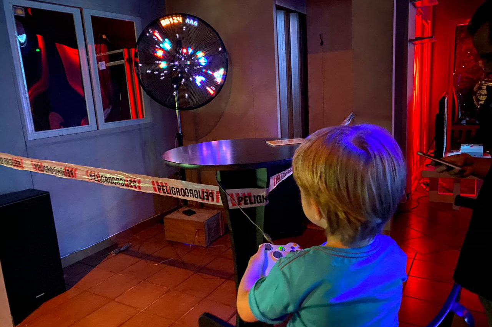
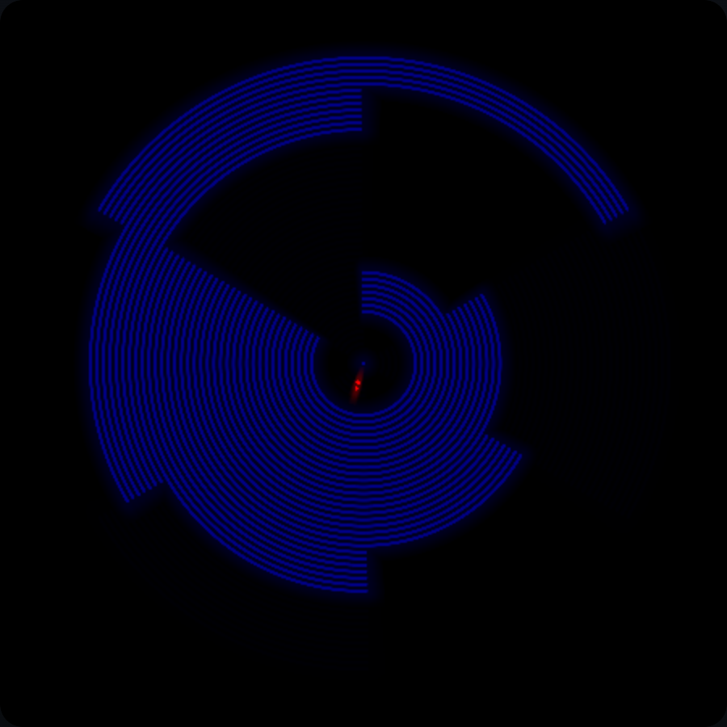
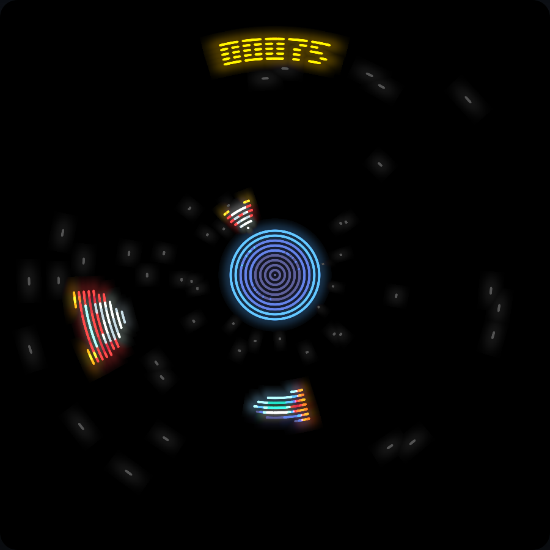
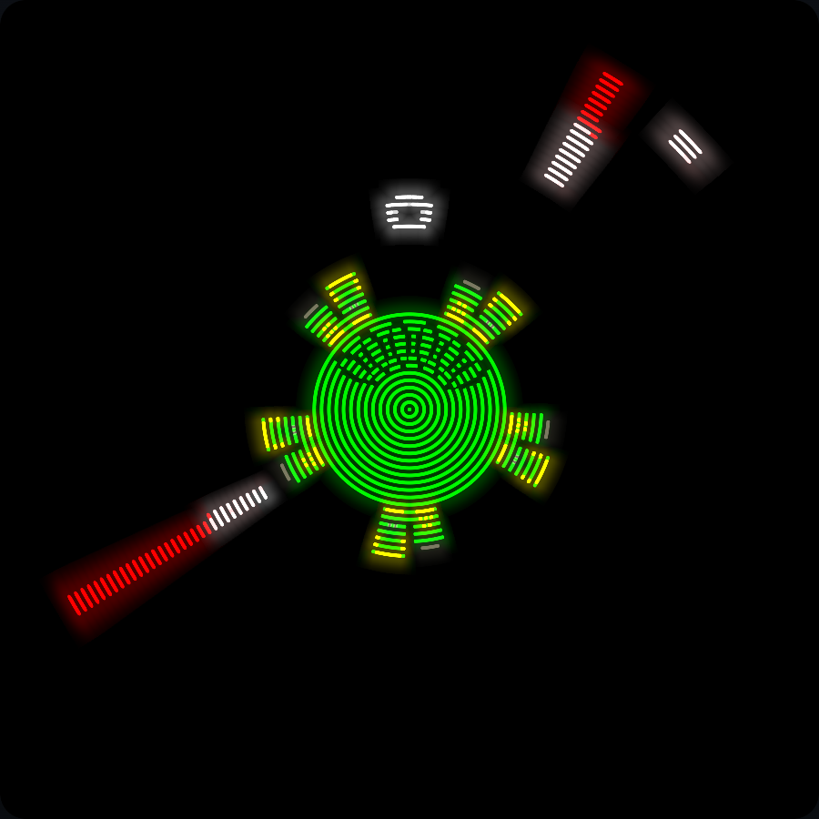
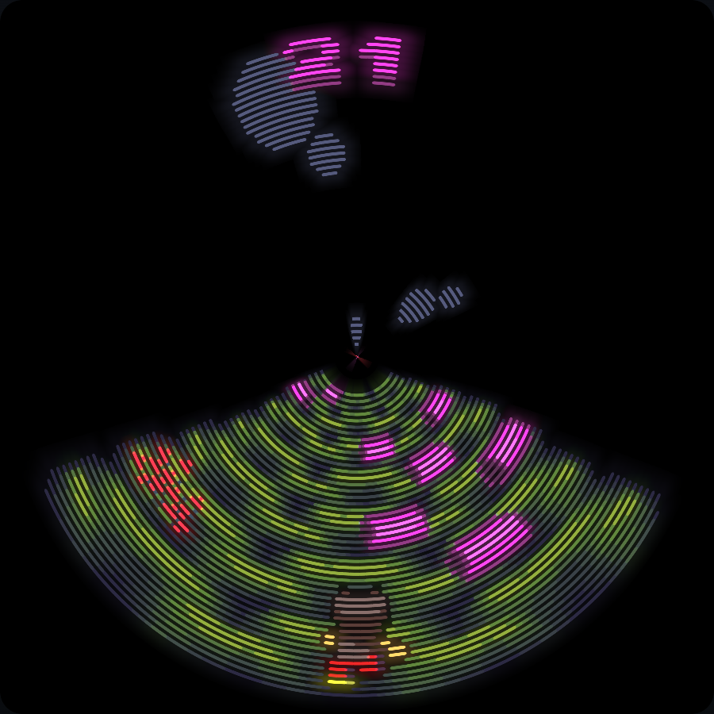

<!-- .slide: id="spinning-computer" data-talk-part="opening" data-timing="25" class="cover" data-background-image="../making-games/assets/cover.jpg" data-background-opacity="0.18" -->

Ventilastation · 2012–2026

# A computer on a spinning arm

The hardware and software behind a circular arcade

Alejandro J. Cura <!-- .element: class="byline" -->

Notes:
**0:00–0:25.**
Start with the physical object: this computer spins inside a fan, and it runs games. The story is about how a purpose-built game grew into a console other people can program. Follow the hardware and the software together: each generation changes what the other can do. The current-state material is based on SDK main at 451941f, October 13, 2026; research cutoff October 18, 2026.

[Sources]
- Cover: [existing presentation asset](../making-games/assets/cover.jpg), originally website `images/banner.jpg`.
- [Current SDK](https://github.com/ventilastation/vsdk/tree/451941fa66341ec22f09aa39fb5147b58b3e83fa).
[/Sources]

---

<!-- .slide: id="a-console-for-people" data-talk-part="opening" data-timing="45" -->

## The fan is a game console

Games run on the rotating board.

A stationary base handles <strong>controllers and sound</strong>.

People can build games without owning the fan.

Notes:
**0:25–1:10.**
Orient the audience before introducing the generations. There is a game computer in the arm, rather than a laptop sending a movie to the LEDs. The stationary base reads the controllers and plays the audio requested by the game. On a development computer, the emulator replaces the physical display and base. That last capability is central to the change from a single installation to a platform other people can use. We will come back to the same boundary throughout the talk.

[Sources]
- [Hardware platform](https://github.com/ventilastation/vsdk/blob/451941fa66341ec22f09aa39fb5147b58b3e83fa/apps/micropython/ventilastation/platforms/hardware.py).
- [Base responsibilities](https://github.com/ventilastation/vsdk/blob/451941fa66341ec22f09aa39fb5147b58b3e83fa/hardware/base/README.md).
- Photo: [existing talk asset](../making-games/assets/vs-gameon.jpg), supplied by Alejandro J. Cura.
[/Sources]

---

<!-- .slide: id="screen-made-of-time" data-talk-part="opening" data-timing="80" -->

## This screen is made of time

256 × 54

Angular columns × radial positions

A magnet and Hall sensor establish each turn.

<strong>107 physical LEDs</strong> span two opposed arms, sharing the centre.

Notes:
**1:10–2:30.**
Explain persistence of vision through one LED: it travels in a circle, and we change its colour at different angles. The bar paints a polar image over time. The current target has 256 angular columns and 54 radial positions. The physical strip crosses the centre: 54 plus 54 minus one shared LED gives 107, rather than 108. A Hall sensor sees a fixed magnet once per revolution; elapsed time since that event estimates angle. The visible light cells are arcs, called arxels. Their physical width depends on radius. These are the current dimensions, not the dimensions of every historical prototype. Motor rotation, game updates and column service are separate clocks.

[Sources]
- [Display geometry constants](https://github.com/ventilastation/vsdk/blob/451941fa66341ec22f09aa39fb5147b58b3e83fa/hardware/rotor/modules/povdisplay/display_geometry.h).
- [Shared centre LED and Hall timing](https://github.com/ventilastation/vsdk/blob/451941fa66341ec22f09aa39fb5147b58b3e83fa/hardware/rotor/modules/povdisplay/povdisplay.c).
- Image: [arxel illustration from the existing talk](../making-games/assets/display-arxels.png), rendered with the SDK's WebGL display backend; provenance in that talk's `assets/captures.json`.
[/Sources]

---

<!-- .slide: id="generations" data-talk-part="history" data-timing="60" class="history" -->

The architecture changes in stages

## One game grows into a platform

<ol class="timeline">
<li><time>2012–2013</time>Super Hexagon, a POV idea, a seven-LED prototype</li>
<li><time>2015</time>Super Ventilagon: an Arduino game inside a fan</li>
<li><time>2018–2019</time>ESP32, MicroPython, sprites and a desktop emulator</li>
<li><time>2023–2025</time>The original game returns; VSDK, ESP32-S3 and jams</li>
<li><time>2026</time>Browser runtime, native apps, VS2 and hardware testing</li>
</ol>

Notes:
**2:30–3:30.**
Use this as a map, not a list of release dates. The older presentation places Super Hexagon in 2012, the PyCamp seven-LED experiment in 2013, Super Ventilagon in 2015 and Ventilastation in 2019. Git adds a useful refinement: the first Ventilastation-specific ESP32 prototype commit is November 2018, before the 2019 public-era label. A repository's first commit can also be inherited upstream history, so we should not date Ventilastation from the LoBo fork's January 2018 root commit. Keep 2012 as the origin of the story; the exact idea-versus-prototype date is an author question recorded in the presenter guide.

[Sources]
- [Earlier history talk](../../dump2024/), particularly frames “Super Hexagon”, “PyCamp 2013”, “2015: Super Ventilagon”, and “2019: Ventilastation”. The checked-in Sozi source has later edits and a 2025 title despite the directory name.
- [First ESP32 prototype, November 18, 2018](https://github.com/alecu/ventilastation/commit/9435a21ca5d2fa00211896c9ca45e2f50d53172d).
- [VSDK starts in August 2024](https://github.com/ventilastation/vsdk/commit/30f36d2).
[/Sources]

---

<!-- .slide: id="first-prototype" data-talk-part="history" data-timing="90" class="history" -->

2012–2013 · The origin

## Seven LEDs prove the idea

Ethernet cable, seven LEDs, tape — and a motor. <!-- .element: class="caption" -->

Notes:
**3:30–5:00.**
Super Hexagon supplied a game idea whose circular motion suited a POV display. The earlier talk also shows Monkeylectric as a visual reference. At PyCamp 2013 in Villa Giardino, the practical experiment used Ethernet cable, seven LEDs and painter's tape; its frame title credits a motorised fisa. It answers a small question: can this motion make a legible image? It does not yet prove a complete arcade machine. Briefly mention the Club de Jaqueo setting: shared tools, electronics knowledge and people willing to try the idea. Reflektor, the earlier laser-and-mirrors game, can be a short spoken connection if useful, but keep this talk on the fan's architecture.

[Sources]
- [History talk and photos](../../dump2024/): frames “Super Hexagon, 2012”, “Monkeylectric”, “PyCamp 2013, Villa Giardino”, “Cable ethernet, 7 leds, cinta de pintor”, “Más un fisa motorizado”, “Hola mundo”.
- Images: [prototype](../../dump2024/images/vsdump_45.jpg), [spinning experiment](../../dump2024/images/vsdump_49.jpg), reused from that talk. Individual photographer attribution is unresolved; see the source ledger.
[/Sources]

---

<!-- .slide: id="arduino-hardware" data-talk-part="history" data-timing="90" class="history" -->

2015 · Super Ventilagon

## The first arcade runs on a Nano

<strong>Arduino Nano</strong> on the rotor

32 RGB LEDs with TLC5940 drivers, plus the ship LED

Hall sensor, Wixel radio and a phone battery

A Raspberry Pi stays in the base.

Notes:
**5:00–6:30.**
Now the experiment is a particular playable game. Describe the Nano as an ATmega328P-class 8-bit processor at 16 MHz with 2 KB of RAM and 32 KB of flash, as compared in the earlier talk. TLC5940 constant-current drivers control the RGB LEDs; this is not the later APA102-style serial strip. The earlier component list calls it 32 plus one LEDs, and the source separates Ship from Ledbar. The phone battery rotates with the board, and Wixel provides the serial radio link to the stationary machine. The magnet and Hall sensor solve the angular reference problem. The servo-driven needle and physical controls make the base more than a pair of speakers.

[Sources]
- [2015 rotor definitions](https://github.com/clubdejaqueo/super-ventilagon/blob/f4040113e562af43333f63e0271c6e80e2c610c0/ventilagon_rotor/definitions.h).
- [TLC5940 LED driver code](https://github.com/clubdejaqueo/super-ventilagon/blob/f4040113e562af43333f63e0271c6e80e2c610c0/ventilagon_rotor/ledbar.ino).
- [History talk](../../dump2024/), component and Arduino/ESP32 comparison frames; [arm photo](../../dump2024/images/vsdump_48.jpg).
[/Sources]

---

<!-- .slide: id="arduino-software" data-talk-part="history" data-timing="85" class="history" -->

2015 · Software follows the physical split

## The rotor owns the game

<strong>Stationary base</strong>Controllers · Raspberry Pi Audio · servo · lights

⇄

<strong>Wixel serial radio</strong>Buttons toward the rotor Sound and control commands back

⇄

<strong>Arduino rotor</strong>Game states · collision Hall timing · LED output

Small commands cross the boundary.

Notes:
**6:30–7:55.**
Read the arrows in both directions. On the rotor, setup configures the Hall interrupt and serial port; loop delegates to the current state's loop. The State hierarchy implements resetting, play, game over, win and credits. Board owns a circular buffer of wall patterns, Display calculates angular position, and Ship and Ledbar drive the lights. Serial input uses characters such as uppercase L and R for presses and lowercase l and r for releases. Audio methods print tiny commands: the base produces sound, rather than receiving a stream of samples. The game board has six logical sectors and 32 radial rows; do not confuse that representation with the modern 256-column renderer. This division is the durable part of the design.

[Sources]
- [2015 entry point and input parser](https://github.com/clubdejaqueo/super-ventilagon/blob/f4040113e562af43333f63e0271c6e80e2c610c0/ventilagon_rotor/ventilagon_rotor.ino).
- [Game board](https://github.com/clubdejaqueo/super-ventilagon/blob/f4040113e562af43333f63e0271c6e80e2c610c0/ventilagon_rotor/board.ino), [display timing](https://github.com/clubdejaqueo/super-ventilagon/blob/f4040113e562af43333f63e0271c6e80e2c610c0/ventilagon_rotor/display.ino), [audio commands](https://github.com/clubdejaqueo/super-ventilagon/blob/f4040113e562af43333f63e0271c6e80e2c610c0/ventilagon_rotor/audio.ino).
[/Sources]

---

<!-- .slide: id="first-generation-limits" data-talk-part="history" data-timing="55" class="history" -->

## A great game needs a bigger machine

<strong>2 KB RAM</strong> constrains the game and graphics.

C++ ties game logic closely to the display.

Motor heat and maintenance constrain the installation.

Notes:
**7:55–8:50.**
The earlier talk describes the result as fun and visually captivating, while explicitly calling out limited graphics, difficult programming and a motor that overheats and burns out. Present those as lessons from the installation. The source makes the coupling concrete: changing the game means changing a small embedded C++ program and its specialised display routines. The next-generation design opens up graphics and Python game development while keeping real-time light output in C. Treat that as an architectural reading of the changes, not a fabricated quotation about the author's exact motivation.

[Sources]
- [History talk](../../dump2024/), “Super Ventilagon: aprendizajes” and CPU comparison; [game photo](../../dump2024/images/vsdump_50.jpg).
- [2015 state and display interfaces](https://github.com/clubdejaqueo/super-ventilagon/blob/f4040113e562af43333f63e0271c6e80e2c610c0/ventilagon_rotor/definitions.h).
[/Sources]

---

<!-- .slide: id="esp32-and-python" data-talk-part="history" data-timing="95" class="history" -->

2018–2019 · Ventilastation

## Python games, C display timing

<strong>ESP32</strong> replaces the Nano.

MicroPython manages scenes, input and game rules.

A C renderer maps sprites onto the spinning LEDs.

107 APA102 LEDs enable richer graphics.

Notes:
**8:50–10:25.**
This is the central software boundary added in the second generation: Python expresses the game, while C handles timing and rendering. The first project-specific commit in November 2018 adds a POV module inside a fork of LoBo's MicroPython for ESP32 with PSRAM support. Explain why the old repository looks like an entire language runtime: it really contains the firmware fork and build system. The earlier talk labels this generation Ventilastation, 2019, and lists a 240 MHz, 32-bit ESP32 with 520 KB of internal RAM and 4 MB of flash, alongside 107 APA102 LEDs. Those numbers describe that historical generation; they are not the current S3 flash layout. That component list still includes a Wixel and a dismantled power bank. Slip-ring adoption belongs later, with the date awaiting confirmation.

[Sources]
- [First ESP32 prototype](https://github.com/alecu/ventilastation/commit/9435a21ca5d2fa00211896c9ca45e2f50d53172d).
- [Historical firmware-fork README](https://github.com/alecu/ventilastation/blob/c39710f/README.md).
- [Historical director](https://github.com/alecu/ventilastation/blob/c39710f/vyruss/python/director.py), [C renderer](https://github.com/alecu/ventilastation/blob/c39710f/vyruss/c/gpu.c).
- [History talk](../../dump2024/), 2019 component list and [photo](../../dump2024/images/vsdump_65.jpg).
[/Sources]

---

<!-- .slide: id="desktop-origin" data-talk-part="history" data-timing="75" class="history" -->

2019 · Develop without the fan

## The emulator opens the project up

The same MicroPython game runs on a computer.

A desktop host draws the disc, reads input and plays sound.

<strong>The hardware boundary becomes a development interface.</strong>

Notes:
**10:25–11:40.**
Credit manuq and SAn: the February 12, 2019 import says the emulator was originally made by san and manuq, and the project's credits name them. March commits add TCP sprite updates, joystick support and a more robust single-socket connection, including work on the PyCamp 2019 branch. The important substitution is architectural: a host process takes the place of the display and base. MicroPython still runs the game. Graphics state and commands cross a process boundary; they do not need the mechanical machine. This is why a game jam becomes possible. Avoid saying the entire emulator was first written at PyCamp: the February import predates the March PyCamp commits.

[Sources]
- [Emulator import, February 12, 2019](https://github.com/alecu/ventilastation/commit/67c0cf6).
- [TCP sprite updates, March 3](https://github.com/alecu/ventilastation/commit/b1b9578), [single-socket connection, March 12](https://github.com/alecu/ventilastation/commit/d53a5ad).
- [Credits](https://github.com/alecu/ventilastation/blob/c39710f/vyruss/README.md).
- [Emulator image](../../dump2024/images/vsdump_%2013.png) from the history talk; the source labels the emulator's origin as PyCamp 2019, but the capture itself is undated.
[/Sources]

---

<!-- .slide: id="original-game-returns" data-talk-part="history" data-timing="55" class="history" -->

2023 · Keep the original game alive

## Super Ventilagon joins the console

The Arduino game moves into the ESP32 C modules.

A Python scene enters and leaves the native game.

FreeRTOS queues connect it to the normal host services.

Notes:
**11:40–12:35.**
In August and September 2023 the old game is migrated from Arduino C++ into C within the ESP32 firmware. The commits explicitly show a new ventilagon module, entering and exiting its display, and queues between the Ventilagon task, MicroPython and communications. This is a compatibility strategy: the console can host a specialised original game without rewriting it into the sprite API. Distinguish this from today's heavier Retro-Go apps, which boot separate firmware partitions. This slide's screenshot comes from the 2026 emulator, not from 2023. The history is in the source migration, not the capture date.

[Sources]
- [C port, August 30, 2023](https://github.com/alecu/ventilastation/commit/4ed9bc8), [native module](https://github.com/alecu/ventilastation/commit/be51fad), [FreeRTOS queues](https://github.com/alecu/ventilastation/commit/f893781).
- Screenshot: [existing WebGL catalog capture](../making-games/assets/catalog-super-ventilagon.png); capture record in `../making-games/assets/catalog-captures.json`.
[/Sources]

---

<!-- .slide: id="sdk-repository" data-talk-part="history" data-timing="80" class="history" -->

2024 · A development kit of its own

## VSDK separates the project from the fork

<table class="ledger">
<thead><tr><th>Repository</th><th>Architectural role</th></tr></thead>
<tbody>
<tr><td>super-ventilagon</td><td>Arduino game and physical controls · 2015</td></tr>
<tr><td>alecu/ventilastation</td><td>MicroPython firmware fork, games and emulator · 2018–2024</td></tr>
<tr><td>ventilastation/vsdk</td><td>SDK, games, hosts and hardware modules · August 2024 onward</td></tr>
</tbody>
</table>

Upstream MicroPython + user C modules + ESP32-S3

Notes:
**12:35–13:55.**
The three repositories are not three complete rewrites, and their root commit dates are not product launch dates. VSDK begins August 21, 2024 with an import of emulator and apps, followed by an asset-generation cleanup. October commits port the POV C modules to vanilla MicroPython; October 17 records the ESP32-S3 working. The old repository is emptied and redirected in June 2025, after the new one is already in use. The new tree separates the game runtime, games, system scenes, hardware, desktop host and web host. The build uses an upstream MicroPython checkout, and Retro-Go is a submodule. This reduces the amount of language-runtime fork the project must carry while preserving its native hardware code.

[Sources]
- [VSDK import](https://github.com/ventilastation/vsdk/commit/6b799b9), [vanilla MicroPython modules](https://github.com/ventilastation/vsdk/commit/7206324), [ESP32-S3 working](https://github.com/ventilastation/vsdk/commit/e1485bc).
- [Old repository redirect, June 12, 2025](https://github.com/alecu/ventilastation/commit/31aa4881dc94519ff3c08e8ed84b40c31628fc6a).
- [Current SDK layout](https://github.com/ventilastation/vsdk/blob/451941fa66341ec22f09aa39fb5147b58b3e83fa/README.md).
[/Sources]

---

<!-- .slide: id="games-drive-api" data-talk-part="history" data-timing="55" class="history" -->

2025 · More people, more kinds of games

## Game jams expand the design space

<figure><figcaption>Vasura Espacial</figcaption></figure>
<figure><figcaption>Senile command</figcaption></figure>
<figure><figcaption>Tincho el Carpincho</figcaption></figure>

Game code, artwork and audio become independent contributions.

Notes:
**13:55–14:50.**
Show what the platform enables. These are games from the May and October 2025 jam groups, captured later with the current WebGL emulator. The repository carries their original game code; contributors do not all need to become firmware developers. In the current tree each game has code, images, sounds, a menu tile and metadata. This is the practical setting for stronger scene ownership and reusable display services in the later VS2 API. Phrase that relationship as our interpretation of the architectural needs, unless the author confirms a more specific motivation. Credit creators through the linked source folders and their metadata rather than guessing names from the title.

[Sources]
- [Vasura Espacial](https://github.com/ventilastation/vsdk/tree/451941fa66341ec22f09aa39fb5147b58b3e83fa/games/vsjam-may25/vasura_espacial).
- [Senile command](https://github.com/ventilastation/vsdk/tree/451941fa66341ec22f09aa39fb5147b58b3e83fa/games/vsjam-oct25/2bam_sencom).
- [Tincho el Carpincho](https://github.com/ventilastation/vsdk/tree/451941fa66341ec22f09aa39fb5147b58b3e83fa/games/vsjam-oct25/tincho_vrunner).
- Images: [Vasura Espacial](../making-games/assets/catalog-vasura-espacial.png), [Senile command](../making-games/assets/catalog-senile-command.png), [Tincho](../making-games/assets/catalog-tincho.png); backend and hashes in [the capture record](../making-games/assets/catalog-captures.json).
[/Sources]

---

<!-- .slide: id="current-hardware" data-talk-part="current" data-timing="100" -->

Current architecture · October 2026

## Power and serial cross the axle

<strong>Base</strong>Raspberry Pi host Controllers · speakers Arduino: lights · servo

⇄

<strong>Slip ring</strong>External 5 V power UART in both directions Continuous rotation

⇄

<strong>Rotor</strong>ESP32-S3 · 107 LEDs Hall sensor · magnet reference Game and display firmware

The fan motor supplies motion; the rotor supplies the image.

Notes:
**14:50–16:30.**
Compare this directly with the 2015 diagram. The logical boundary survives, while the physical crossing changes: the documented assembly uses a through-hole slip ring for external 5 V power and serial data. The stationary Raspberry Pi can run the same host software in headless console mode: controller input and audio continue without a preview window. A dedicated Arduino drives the base's RGB strip, button lights and servo needle. The slip ring has stationary and rotating sides; the motor supplies the motion. The build documentation describes a 30-inch industrial fan and a six-lane ring rated for 1500 RPM, with operation around 600 RPM. The SDK targets ESP32-S3 and a 16 MB flash layout. The colour-pipeline documentation says current rotors use NS107S LEDs with the APA102-compatible wire format. Installed revisions and the transition date need author confirmation; do not assume every deployed console is identical.

[Sources]
- [Mechanical assembly and slip ring](https://github.com/ventilastation/vsdk/blob/451941fa66341ec22f09aa39fb5147b58b3e83fa/hardware/rotor/3dmodels/Mechanical%20Assembly.md).
- [S3 board definition](https://github.com/ventilastation/vsdk/blob/451941fa66341ec22f09aa39fb5147b58b3e83fa/hardware/rotor/boards/VENTILASTATION/mpconfigboard.h).
- [Current LED type and colour pipeline](https://github.com/ventilastation/vsdk/blob/451941fa66341ec22f09aa39fb5147b58b3e83fa/docs/internals/pov-color-pipeline.md).
- [Headless host engine](https://github.com/ventilastation/vsdk/blob/451941fa66341ec22f09aa39fb5147b58b3e83fa/emulator/consoleengine.py), [base Arduino firmware](https://github.com/ventilastation/vsdk/blob/451941fa66341ec22f09aa39fb5147b58b3e83fa/hardware/base/vsbase_arduino/vsbase_arduino.ino).
[/Sources]

---

<!-- .slide: id="display-deadlines" data-talk-part="current" data-timing="125" -->

## Light output has a deadline

<h3>Core 1 · MicroPython</h3>

Input, scene lifecycle and game updates

Changes the scene's display state

Normal update interval: about 30 ms

<h3>Core 0 · C display task</h3>

Hall timing and SPI column service

Projects the next image between deadlines

Publishes a completed polar framebuffer

600 RPM → 100 ms / turn → <strong>391 µs / column</strong>

Notes:
**16:30–18:35.**
The numerical example is a calculation, not a performance benchmark: 600 divided by 60 is ten turns per second, so a turn lasts 100,000 microseconds; divide by 256 to get 390.625 microseconds per angular column. Two opposed arms each emit a column at that moment, half a turn apart. The game loop targets roughly 30 ms and is not synchronised to a revolution. In the current MicroPython path, coreTask is pinned to core 0. It serves columns first, then projects a column into the back buffer when there is slack. The VS2 compositor can cooperatively call column service during heavier work. Two 256×54 buffers contain completed APA102 words, and publishing swaps which buffer is front. MicroPython runs on core 1. A stale comment describes an independent render task on core 1, but the actual loop and the July 23 single-task fix show projection in coreTask. State this carefully: the framebuffer separates projection work from the immediate light-output job; it does not remove the cost or all scheduling constraints. Original Ventilagon still has its specialised continuous rendering path.

[Sources]
- [Actual coreTask, project_has_slack, project_next_column and gpu_serve](https://github.com/ventilastation/vsdk/blob/451941fa66341ec22f09aa39fb5147b58b3e83fa/hardware/rotor/modules/povdisplay/povdisplay.c).
- [Core 0 definition](https://github.com/ventilastation/vsdk/blob/451941fa66341ec22f09aa39fb5147b58b3e83fa/hardware/rotor/modules/povdisplay/minispi.h), [MicroPython core configuration](https://github.com/ventilastation/vsdk/blob/451941fa66341ec22f09aa39fb5147b58b3e83fa/hardware/rotor/boards/VENTILASTATION/sdkconfig.board).
- [30 ms director loop](https://github.com/ventilastation/vsdk/blob/451941fa66341ec22f09aa39fb5147b58b3e83fa/apps/micropython/ventilastation/director.py).
- [Single-task correction, July 23, 2026](https://github.com/ventilastation/vsdk/commit/8946100).
[/Sources]

---

<!-- .slide: id="vs2-scene-ownership" data-talk-part="current" data-timing="100" -->

July 2026 · VS2 API revision 2

## Build the scene, then update its state

<strong>Scene → layers → drawables</strong>

<code>build()</code> creates the display graph.

<code>update()</code> moves and reuses its objects.

Pools reserve capacity. Labels use tilemaps.

8 layers · 100 sprites · 16 tilemaps on the current target

Notes:
**18:35–20:15.**
The accepted API revision 2 was implemented and merged in July 2026. Explain ownership rather than walking through API syntax. A scene owns layers; each layer owns its projection and its drawables. Creation order controls painting, so backgrounds, game objects and HUD have explicit places. Build creates and seals the render graph. Update can change positions, frames, visibility and reserved pool members, but cannot add new render objects. This is not a general guarantee of zero Python allocations or a ban on garbage collection. Pools make render capacity explicit; labels are tilemaps rather than one sprite per letter. The director queues transitions and stops further game callbacks that tick. Timers belong to the current showing and are discarded when it exits or is suspended. V1 games retain a compatibility path; the runtime guards against mixing the two APIs. The image is a recent example, not a claim that VS2 started with Dream Garden.

[Sources]
- [Accepted VS2 decisions](https://github.com/ventilastation/vsdk/blob/451941fa66341ec22f09aa39fb5147b58b3e83fa/docs/internals/vs2-decisions.md).
- [API implementation](https://github.com/ventilastation/vsdk/blob/451941fa66341ec22f09aa39fb5147b58b3e83fa/apps/micropython/vs2/__init__.py).
- [Sealed API implementation](https://github.com/ventilastation/vsdk/commit/a258076), [merge](https://github.com/ventilastation/vsdk/commit/d230a1f).
- Screenshot: [existing WebGL Dream Garden capture](../making-games/assets/dream-garden.png); provenance in `../making-games/assets/captures.json`.
[/Sources]

---

<!-- .slide: id="asset-pipeline" data-talk-part="current" data-timing="65" -->

## One asset format feeds every target

PNG + __images__.yaml ↓ Indexed image strips + palettes + glyph maps ↓ Sprite ROM → rotor · desktop · browser

Audio files stay on the base or emulator host.

Notes:
**20:15–21:20.**
A game directory separates code, images, sounds, menu artwork and metadata. The asset builder quantises images into palette-indexed strips with animation frames and optional glyph mappings. The same container is built by the Python and browser/Node tools and consumed across platforms. The current strip header stores width and frame count minus one, allowing 256 in one byte; mention this only if the audience wants a concrete portability lesson. On flash, sprite ROMs can be compressed as romz and inflated into one preallocated buffer. A sprite ROM is graphics data. Sound and music files do not go into it, and the filesystem builder skips the game's sounds on the rotor. The base or emulator host keeps the audio. Existing-game compatibility is handled at the format boundary rather than requiring people to rebuild every old contribution at once.

[Sources]
- [Normative sprite ROM specification](https://github.com/ventilastation/vsdk/blob/451941fa66341ec22f09aa39fb5147b58b3e83fa/docs/internals/rom-format.md).
- [Rotor filesystem builder](https://github.com/ventilastation/vsdk/blob/451941fa66341ec22f09aa39fb5147b58b3e83fa/hardware/rotor/build_micropython_fs.py).
- [Game layout and discovery](https://github.com/ventilastation/vsdk/blob/451941fa66341ec22f09aa39fb5147b58b3e83fa/apps/micropython/ventilastation/catalog.py).
[/Sources]

---

<!-- .slide: id="browser-runtime" data-talk-part="current" data-timing="90" -->

2026 · The browser becomes another host

## MicroPython runs inside the browser

<table class="ledger">
<tbody>
<tr><td>Worker</td><td>MicroPython compiled to WebAssembly; game and scene logic</td></tr>
<tr><td>Bridge</td><td>Input in; display state and host commands out</td></tr>
<tr><td>Main thread</td><td>WebGL display, controllers, audio and editing</td></tr>
</tbody>
</table>

Frequent payloads cross as pointer + length.

Notes:
**21:20–22:50.**
The historical repository had a JavaScript display experiment; the 2026 browser runtime adds MicroPython compiled to WebAssembly, running in a worker. This is still a Python game, not a JavaScript rewrite. The worker mounts the runtime bundle, receives input, and sends frame events and audio commands to the UI thread. WebGL composes scenes and presents the circular display, with a fallback path when necessary. March 2026 commits add and tune the WASM runtime and worker scheduler; June adds the Monaco editor. A useful architectural bug: passing fresh Python byte objects into JavaScript every frame caused retained heap growth in this build. Pointer-and-length calls let the worker read existing WASM memory and avoid that bridge leak. Do not describe that as end-to-end zero-copy: the worker still constructs JavaScript payloads. Public onboarding currently directs new developers to the desktop emulator; this slide describes the implemented browser architecture, not a change to that recommendation.

[Sources]
- [Browser architecture and bridge memory rule](https://github.com/ventilastation/vsdk/blob/451941fa66341ec22f09aa39fb5147b58b3e83fa/docs/internals/web-emulator-architecture.md).
- [Worker scheduler, March 2026](https://github.com/ventilastation/vsdk/commit/8b044ce), [Monaco IDE, June 2026](https://github.com/ventilastation/vsdk/commit/0a5340d).
- [Current onboarding constraints](https://github.com/ventilastation/vsdk/blob/451941fa66341ec22f09aa39fb5147b58b3e83fa/docs/internals/remote-workbench-access.md).
[/Sources]

---

<!-- .slide: id="host-protocol-and-audio" data-talk-part="current" data-timing="80" -->

## The base turns commands into sound

<h3>Base → rotor</h3>

Two players' button states

Control and update commands

<h3>Rotor → base</h3>

Sound and music requests

Lights, servo and diagnostics

Native sound-chip register logs

115200 baud ≈ <strong>11.5 KB/s</strong> at 8N1

Notes:
**22:50–24:10.**
Return to the 2015 principle with a richer protocol. Input protocol v2 carries two joystick states plus extra buttons and an in-band command channel. Outbound host commands include sound, music, lights, servo output and tracebacks. For ordinary games and Voom, short clip requests let the host play local assets. Console emulators generate sound from chip registers, so the newer bridge sends compact register-write logs and reconstructs audio on the host. The bandwidth calculation is 115200 divided by ten serial bits per byte: about 11,520 bytes per second. A 32 kHz, 16-bit stereo stream needs 128,000 bytes per second, so ordinary PCM is far beyond it. The register-log path exists in code and desktop/browser hosts; its documentation still calls for real-hardware audio validation. The physical console does not stream graphics over this UART: it drives LEDs directly. Display packets belong to emulation and workbench transports.

[Sources]
- [Input protocol v2](https://github.com/ventilastation/vsdk/blob/451941fa66341ec22f09aa39fb5147b58b3e83fa/docs/internals/input-protocol-v2.md).
- [Host protocol](https://github.com/ventilastation/vsdk/blob/451941fa66341ec22f09aa39fb5147b58b3e83fa/docs/internals/host-protocol.md).
- [Sound-chip bridge and validation status](https://github.com/ventilastation/vsdk/blob/451941fa66341ec22f09aa39fb5147b58b3e83fa/docs/internals/emulator-audio.md).
[/Sources]

---

<!-- .slide: id="native-firmware" data-talk-part="current" data-timing="90" -->

## Bigger native games boot their own firmware

<table class="ledger">
<thead><tr><th>Flash region</th><th>Purpose</th></tr></thead>
<tbody>
<tr><td>MicroPython</td><td>Normal launcher and Python games</td></tr>
<tr><td>Native apps</td><td>Voom / Doom · Retro-Go console cores · fMSX</td></tr>
<tr><td>LittleFS</td><td>Shared game code, graphics, ROMs and user data</td></tr>
<tr><td>NVS</td><td>Board wiring, calibration and native launch selection</td></tr>
<tr><td>Factory</td><td>Permanent MicroPython recovery environment</td></tr>
</tbody>
</table>

Notes:
**24:10–25:40.**
The current 16 MB partition table contains separate app slots for normal MicroPython, prboom-go, retro-core and fmsx, as well as permanent factory recovery and a shared LittleFS filesystem. Selecting a heavy native app writes launch information and changes the boot partition, then reboots. Native code sets the return target to normal MicroPython, so exit or reset returns to the Python launcher and its saved selection. NVS supplies board wiring and calibration to both worlds; the app partitions do not each hard-code a board revision. Doom and console emulation can own the buffers and timing they need without being forced into a Python extension. This is the implemented partition-switching design. Same-image native takeover appears in older plans and must not be presented as current. Super Ventilagon is the separate counterexample: it is linked into MicroPython's native modules rather than booted as a Retro-Go partition.

[Sources]
- [Actual flash partition table](https://github.com/ventilastation/vsdk/blob/451941fa66341ec22f09aa39fb5147b58b3e83fa/hardware/rotor/partitions-ventilastation.csv).
- [On-device architecture and return semantics](https://github.com/ventilastation/vsdk/blob/451941fa66341ec22f09aa39fb5147b58b3e83fa/docs/internals/on-device-design.md).
- [Native launch C hook](https://github.com/ventilastation/vsdk/blob/451941fa66341ec22f09aa39fb5147b58b3e83fa/hardware/rotor/modules/native_apps/native_apps.c).
[/Sources]

---

<!-- .slide: id="ota-and-recovery" data-talk-part="current" data-timing="80" -->

## Updating the fan becomes a system feature

<ol>
<li><strong>Files:</strong> update changed Python and graphics.</li>
<li><strong>Native apps:</strong> replace a native partition.</li>
<li><strong>MicroPython:</strong> hand off through recovery.</li>
</ol>

Wi-Fi runs on demand. Factory recovery remains available.

Notes:
**25:40–27:00.**
A spinning board makes the development loop a hardware problem: reaching USB can mean stopping and opening the machine. The July 2026 OTA system updates files, native partitions and MicroPython separately. A serial control command requests an update; the board enables Wi-Fi for that session rather than joining at normal boot. File hashes avoid resending unchanged content. A running image cannot overwrite itself, so a MicroPython firmware replacement hands off through the factory recovery environment. Factory is not another normal game runtime, and it is not the earlier proposed two-slot MicroPython A/B arrangement. It remains available when normal firmware fails to confirm its boot. A full first flash still uses USB. Describe the intended operational benefit without claiming a new live update was tested during preparation of this talk.

[Sources]
- [Current three-tier OTA design, recovery and Wi-Fi policy](https://github.com/ventilastation/vsdk/blob/451941fa66341ec22f09aa39fb5147b58b3e83fa/docs/internals/ota.md).
- [Initial OTA implementation, July 4, 2026](https://github.com/ventilastation/vsdk/commit/92d8e80).
- [Rollback configuration](https://github.com/ventilastation/vsdk/blob/451941fa66341ec22f09aa39fb5147b58b3e83fa/hardware/rotor/boards/VENTILASTATION/sdkconfig.board).
[/Sources]

---

<!-- .slide: id="hardware-workbench" data-talk-part="current" data-timing="90" -->

## Test the real board without spinning it

<strong>Host computer</strong>Controls · audio · preview Automated acceptance checks

⇄

<strong>Workbench S3</strong>Simulates Hall pulses Resets and bridges UART Captures the LED SPI bus

⇄

<strong>Real rotor board</strong>Normal firmware Real render and SPI output

Live preview uses UDP; repeatable capture checks use USB with CRC.

Notes:
**27:00–28:30.**
The workbench, introduced in July 2026, is another ESP32-S3 attached to a real rotor board. It generates a Hall-like pulse train, resets the board, bridges its UART to USB, and passively captures the actual APA102-format LED bus. Live frame preview goes over UDP so packet loss does not stall a stream. Automated acceptance can use a checksummed USB capture without Wi-Fi. Timing checks run at 600 and 700 RPM; static pixel-parity checks deliberately run at 400 RPM to separate compositor accuracy from the tighter output deadline. The oracle is the same C compositor and LED encoder compiled for the host. The acceptance document defines gates; it is not itself evidence that the current checkout was tested here. Remote browser access adds authentication, control leasing and WebRTC video around this local arrangement. Neither a bench nor an emulator validates mechanical balance or motor heat, so physical operation remains a separate kind of evidence.

[Sources]
- [Workbench design and transports](https://github.com/ventilastation/vsdk/blob/451941fa66341ec22f09aa39fb5147b58b3e83fa/docs/internals/workbench.md).
- [Hardware acceptance procedure and gates](https://github.com/ventilastation/vsdk/blob/451941fa66341ec22f09aa39fb5147b58b3e83fa/docs/internals/vs2-hardware-acceptance.md).
- [Remote gateway architecture](https://github.com/ventilastation/vsdk/blob/451941fa66341ec22f09aa39fb5147b58b3e83fa/docs/internals/remote-workbench-access.md).
- [Workbench introduction](https://github.com/ventilastation/vsdk/commit/bb9eab0).
[/Sources]

---

<!-- .slide: id="shared-code-shared-evidence" data-talk-part="closing" data-timing="55" -->

## Fidelity improves when the code is shared

<strong>2015:</strong> one game tightly coupled to one display.

<strong>2019:</strong> the game can run away from the machine.

<strong>2026:</strong> hosts reuse the real C renderer and original game core.

Compare bytes and timing across the boundary.

Notes:
**28:30–29:25.**
The latest step returns to the original game. In October 2026 both emulator hosts were changed to compile the rotor's Super Ventilagon C sources, rather than maintain a separate Python simulation or extracted tables. The desktop loads a shared library, while the browser loads a WASM module beside MicroPython. A fixed 100-microsecond simulation step preserves the original game loop's timing independently of presentation rate. Native pixels bypass the Python byte bridge. Desktop sprite/VS2 preview also uses the actual C renderer, and the workbench can compare physical LED bytes with a host oracle. These are different techniques serving the same goal: disagreements should be measurable. Keep scope precise: a browser WebGL compositor remains a separate implementation, and shared code does not prove every hardware or audio path is deployed or validated.

[Sources]
- [Shared Super Ventilagon core and parity tests](https://github.com/ventilastation/vsdk/blob/451941fa66341ec22f09aa39fb5147b58b3e83fa/emulator/ventilagon/README.md).
- [October 13 shared-C change](https://github.com/ventilastation/vsdk/commit/2521a87).
- [Desktop real-C renderer change](https://github.com/ventilastation/vsdk/commit/f329b5f).
[/Sources]

---

<!-- .slide: id="architecture-that-lasts" data-talk-part="closing" data-timing="35" -->

## The boundary made room for more games

Keep light timing close to the LEDs. Give games a stable language and display model. Let every host replace the same physical services.

<a href="https://github.com/ventilastation/vsdk">SDK and hardware</a><a href="../../docs/">Make a game</a><a href="sources.html">History and sources</a>

Notes:
**29:25–30:00.**
Resolve the opening: the computer still spins, but fewer people need to think about the spinning to contribute a game. The project's history is not just a faster CPU. It is a sequence of clearer boundaries: rotor and base, Python and real-time C, games and assets, firmware and recovery, simulation and measured hardware output. Close on the people enabled by those choices: game programmers, artists, musicians and hardware builders can work on different parts of the same console. Invite questions after the timed talk. The unresolved author questions and validation limits are in the presenter guide, not audience-facing claims.

[Sources]
- Architectural synthesis from the three repositories and the specific evidence linked in the preceding slides.
- [Current SDK entry points](https://github.com/ventilastation/vsdk/blob/451941fa66341ec22f09aa39fb5147b58b3e83fa/README.md).
[/Sources]
