<!-- .slide: id="making-games" data-talk-part="intro" data-timing="20" class="cover" data-background-image="assets/cover.jpg" data-background-opacity="0.2" -->

# Ventilastation

Games on a fan

Alejandro Cura <!-- .element: class="byline" -->

Circular Arcades at Sickhouse, 14 October 2026

Notes:
**0:00–0:20.** Introduce the console and the people around it before showing any code. The first twelve minutes are for everyone, including people who do not program. The following fifteen minutes focus on making a circular game. We will launch only three cumulative Garden versions. Questions and open play follow the timed talk.

Source: [Sickhouse’s Circular Arcades meetup](https://www.sickhouse.nl/events/colliders-meet-up-circular-arcades). Cover photo: this website’s images/banner.jpg.

---

<!-- .slide: id="cybercirujas" data-talk-part="intro" data-timing="80" -->

## Cybercirujas

<div class="split">
<div>
<p>An Argentine collective that repairs and recirculates technology.</p>
<p>Shared knowledge, free software and resistance to planned obsolescence.</p>
<p>Ventilastation is part of that community.</p>
</div>
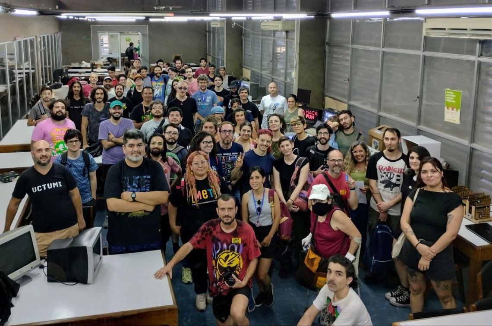
</div>

Notes:
**0:20–1:40.** Cirujeo means finding useful things among what others discard. Cybercirujas extend that practice to computers and electronics, and share the knowledge needed to keep them useful. People contribute repairs, parts, software, teaching and curiosity. Connect this to Ventilastation: an unexpected object becomes a place for shared play. Explain the relationship personally rather than presenting it as a commercial sponsor. Do not imply that this photo shows a specific event or identify people in it.

Source: [UNQ’s account of Cybercirujas](https://agencia.unq.edu.ar/?p=7125), including its interviews with the collective. Photo supplied by Alejandro Cura as cybercirujas.jpg.

---

<!-- .slide: id="console" data-talk-part="intro" data-timing="60" -->

## A game console built around a fan

<div class="split">
<div>
<p>A rotating LED arm draws a circular screen.</p>
<p>An ESP32-S3 runs the game in MicroPython.</p>
<p>Built in Argentina. Open source and open hardware.</p>
</div>

</div>

Notes:
**1:40–2:40.** Point to the moving arm, electronics and fan rather than listing components. It is a console people can write games for, not just a video loop. The code runs on the rotating board. A separate base handles sound and controllers. People can develop on a laptop without building their own hardware.

Sources: [Ventilastation](../../en/), [current SDK introduction](../../docs/vs2/tutorial/index.html). Photo: this website’s images/pic01.jpg.

---

<!-- .slide: id="display-in-time" data-talk-part="intro" data-timing="70" -->

## Light becomes a screen through motion

<div class="split">
<div>
<p>The arm paints a different slice at each angle.</p>
<p>Our eyes join the slices into a disc.</p>
<p>The image has a centre and a rim, with no corners.</p>
</div>
<video src="../../images/banner.mp4" poster="assets/cover.jpg" controls muted loop playsinline data-autoplay aria-label="Ventilastation’s real rotating LED display"></video>
</div>

Notes:
**2:40–3:50.** Play the physical display clip and trace the arm’s rotation with your hand. Each LED follows a circle. Changing its light as it rotates makes a coloured arc. Persistence of vision joins the successive angles into the image. Unlike a stationary rectangular panel, positions on the screen arrive at different instants. The game update and motor rotation are separate clocks. Keep this intuitive for the non-coding audience.

Sources: [Physical display](../../docs/vs2/tutorial/index.html), [display geometry](../../docs/vs2/tutorial/display.html). Video: this website’s images/banner.mp4.

---

<!-- .slide: id="arxels" data-talk-part="intro" data-timing="70" -->

## Arxels get smaller toward the centre

<div class="split">
<div>
<p>An <strong>arxel</strong> is a tiny arc of light.</p>
<p>The same angle covers a wider arc at the rim.</p>
<p>Near the centre, arxels get narrower and details crowd together.</p>
</div>
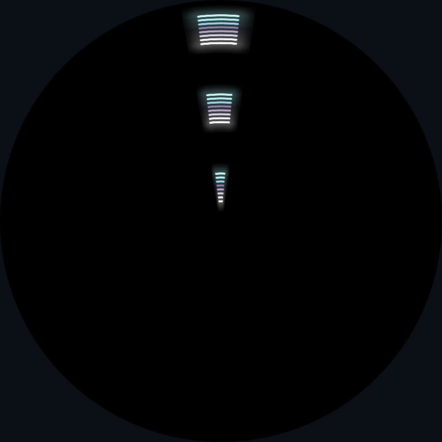
</div>

Notes:
**3:50–5:00.** Arxel combines arc and pixel. These three blocks use the same eight angular columns and eight radial LEDs. Their angular width stays constant, but their physical width shrinks at the smaller radii. Radial LED spacing stays fixed. Distinguish the size of a light cell from an actor shrinking through a tunnel projection. The image uses the HUD projection to isolate the radial geometry. Explain why small lettering and fine artwork become hard to read near the centre. No maths is needed here.

Source: [Current display geometry](../../docs/vs2/tutorial/display.html). Image: actual font block cells rendered through the WebGL display backend.

---

<!-- .slide: id="curved-art" data-talk-part="intro" data-timing="60" -->

## Ordinary artwork bends around the disc

<div class="split">
<div>

<p>PNG artwork becomes curved on the display.</p>
<p>It stretches along the rim, compresses inward and turns with its angle.</p>
</div>

</div>

Notes:
**5:00–6:00.** Show the original flat art and then the four copies around the rim. The renderer maps its horizontal pixels to angular columns and its vertical pixels to radial positions. The result bends and changes proportions. Its local upright direction rotates around the disc. The dreamer’s antennae point inward at every angle. Critical details need to survive that transformation, and a conventional game screen pasted into a circle will not behave like its rectangular original. Invite artists to treat this as a design material.

Source: [Sprite geometry](../../docs/vs2/tutorial/display.html). Images: the real dreamer strip and a WebGL rendering of those assets.

---

<!-- .slide: id="controllers-and-sound" data-talk-part="intro" data-timing="60" -->

## Two joysticks, music and sound

Two joysticks provide **directions and action buttons**.

Games can compete, cooperate or share a space.

Speakers carry **music, effects and feedback** beyond the disc.

Notes:
**6:00–7:00.** Hold up or point to the two physical controllers. Explain that the player input has the familiar joystick directions and buttons, with room for one- and two-player games. The screen is unusual, but those inputs do not require inventing new controllers. Music and effects play through the base station, not through a speaker on the spinning arm. Audio can carry mood, rhythm and events that the crowded centre cannot show clearly. Keyboard controls and the desktop emulator substitute for the hardware during development.

Sources: [Controllers and audio](../../docs/vs2/reference/services.html), [base station](../../en/).

---

<!-- .slide: id="alecu-games" data-talk-part="intro" data-timing="60" -->

## Games made by alecu

<div class="game-gallery">
<figure>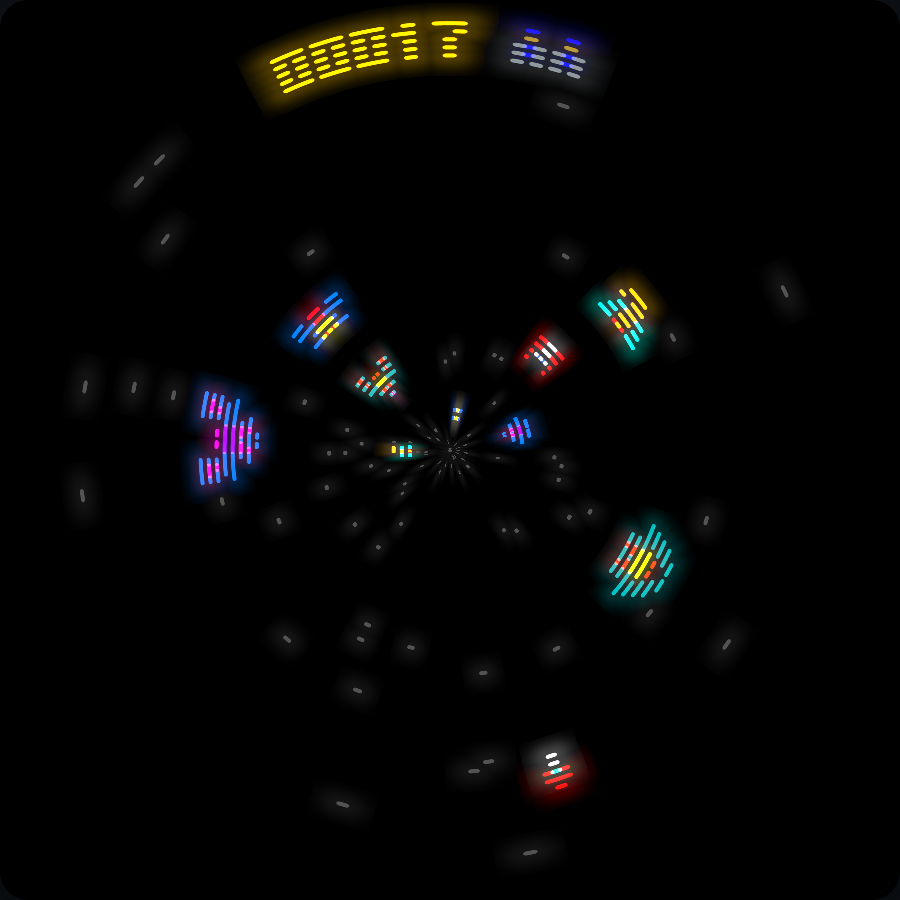<figcaption>Vyruss<br><span>Space shooter</span></figcaption></figure>
<figure>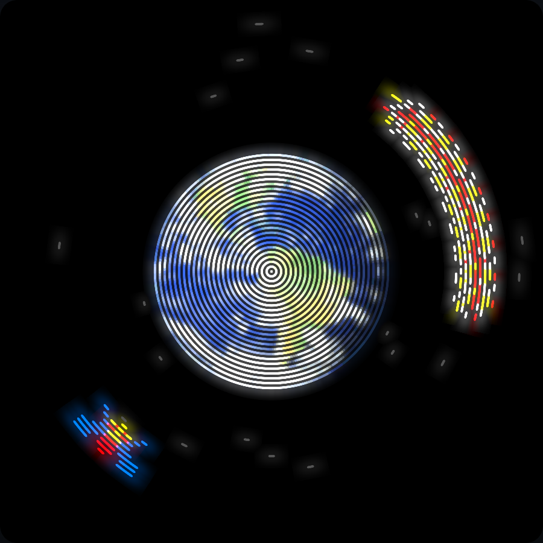<figcaption>Ventap<br><span>Timing and orbits</span></figcaption></figure>
<figure>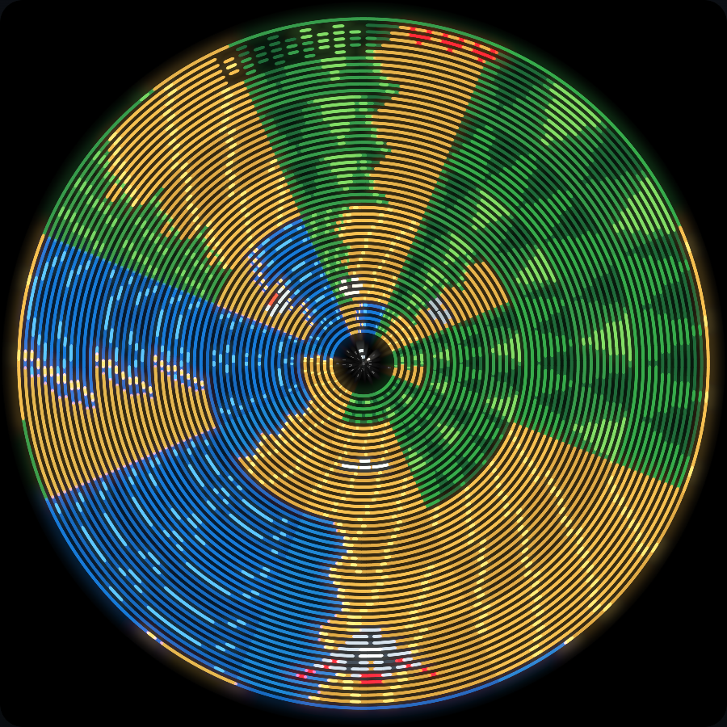<figcaption>Vixeous<br><span>Scrolling shooter</span></figcaption></figure>
</div>

Notes:
**7:00–8:00.** Use these as examples of different ways to inhabit a disc: orbiting a target, moving through depth and flying over terrain. Mention Super Ventilagon as an earlier circular obstacle game and ancestor of this console. Keep game history brief. These are existing games, not promises about what the new jam will produce. The screenshots come from their runnable implementations in the SDK’s alecu group.

Sources: [Vyruss VS2](https://github.com/ventilastation/vsdk/tree/main/games/alecu/vyruss_vs2), [Ventap](https://github.com/ventilastation/vsdk/tree/main/games/alecu/ventap), [Vixeous](https://github.com/ventilastation/vsdk/tree/main/games/alecu/vixeous), [Super Ventilagon](https://ventilagon.protocultura.net/). Images: real games captured with the WebGL display backend.

---

<!-- .slide: id="community-games" data-talk-part="intro" data-timing="70" -->

## The community expands what a disc can do

<div class="game-gallery">
<figure>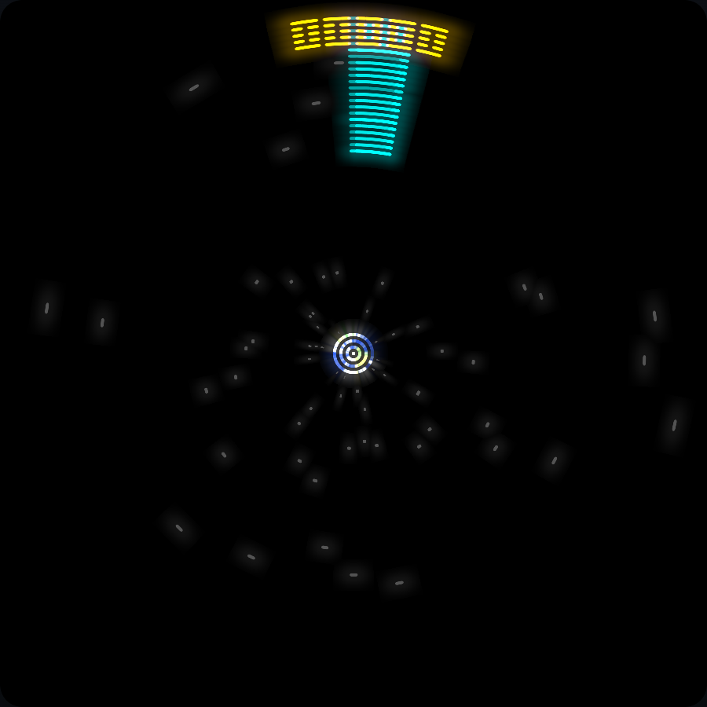<figcaption>Vortris<br><span>Falling blocks</span></figcaption></figure>
<figure>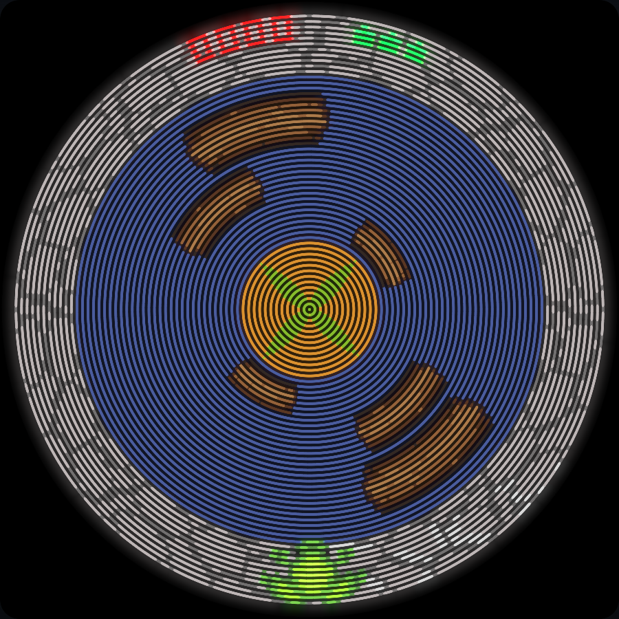<figcaption>Fanphibious Danger<br><span>Frog crossing</span></figcaption></figure>
<figure>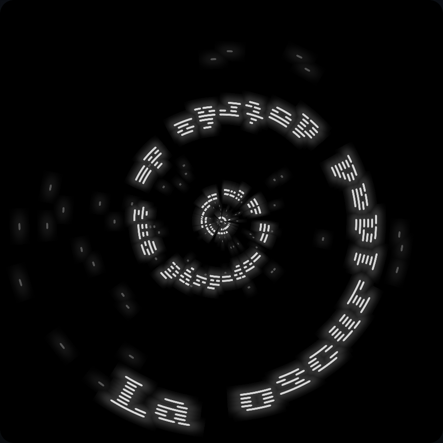<figcaption>Vzumaki<br><span>Spiralling poetry</span></figcaption></figure>
</div>

Notes:
**8:00–9:10.** These examples came from earlier community game jams. Vortris adapts falling blocks to a circular board. Fanphibious Danger makes the crossing lanes circular. Vzumaki uses text and motion for a poetic experience, broadening the idea of a game on this console. Credit the makers collectively and point to the original source folders for their work. Do not infer individual author names from commit history. There are also other community games in the SDK. The point is to invite new approaches, not prescribe a single genre.

Sources: [Vortris](https://github.com/ventilastation/vsdk/tree/main/games/vsjam-may25/vortris), [Fanphibious Danger](https://github.com/ventilastation/vsdk/tree/main/games/vsjam-oct25/fanphibious_danger), [Vzumaki](https://github.com/ventilastation/vsdk/tree/main/games/vsjam-may25/vzumaki). Images: actual games captured with the WebGL display backend.

---

<!-- .slide: id="scenes" data-talk-part="intro" data-timing="50" -->

## Scenes are moments in an experience

<div class="game-gallery">
<figure>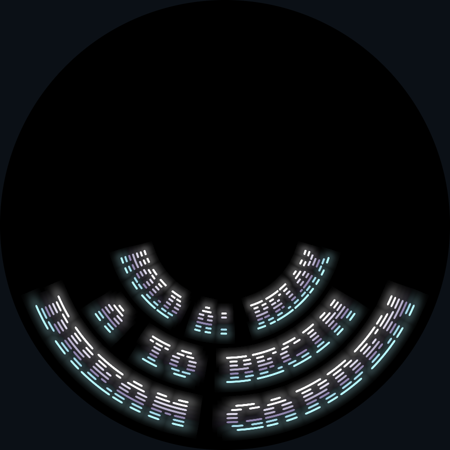<figcaption>Invitation</figcaption></figure>
<figure>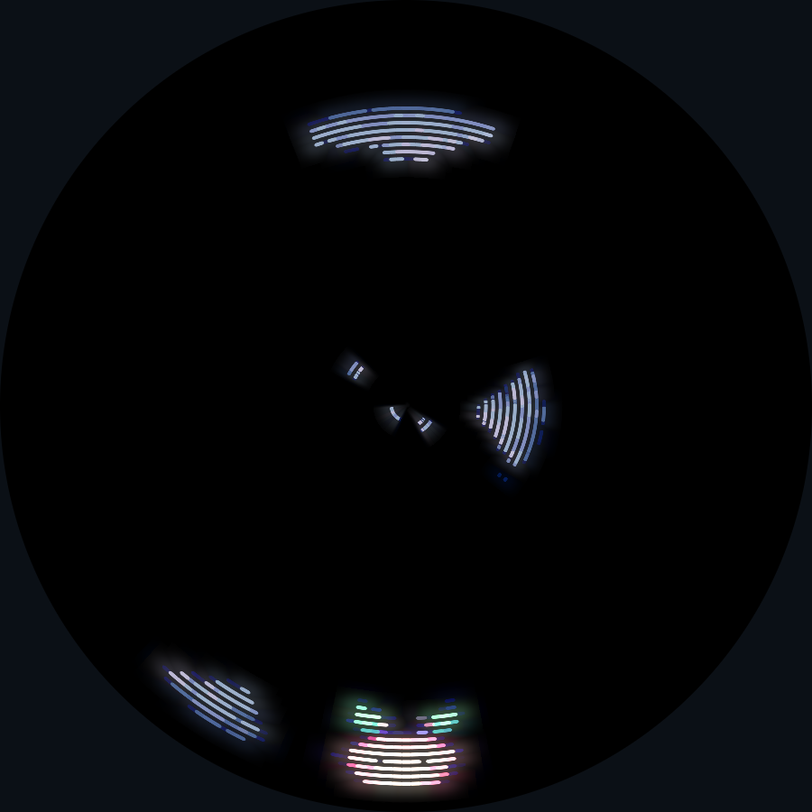<figcaption>Play</figcaption></figure>
<figure><figcaption>Rest</figcaption></figure>
</div>

Notes:
**9:10–10:00.** A scene is one active moment: a title, the playable garden, a pause, a result or a rest. It can have its own pictures, controls and sound decisions. This need not mean lives and a game-over screen. Garden voluntarily switches to Rest, preserving what players planted. Explain the concept before its Python interface so artists and designers can plan an experience too.

Source: [Dream Garden’s Title, Garden and Rest](examples/dream_garden.py). Images: those actual scenes through the WebGL display backend.

---

<!-- .slide: id="visual-pieces" data-talk-part="intro" data-timing="70" -->

## The pieces of a game image

<div class="split">
<div class="glossary">
<p><strong>Layers</strong> choose what draws on top.</p>
<p><strong>Sprites</strong> are movable pictures.</p>
<p><strong>Tilemaps</strong> assemble repeated picture cells.</p>
<p><strong>Labels</strong> turn font cells into text.</p>
<p><strong>Full-screen images</strong> cover the disc with one picture.</p>
</div>

</div>

Notes:
**10:00–11:10.** Point at the image while naming the pieces. Flowers and dreamers form the lower layer. Clouds and golden seeds occupy the middle layer. RELAX is a label on the top layer. The creatures are sprites, and a large cloud spans several tilemap cells. A full-screen image is another option for a backdrop or illustration covering the disc; this garden instead uses sparse clouds. These are tools for visual composition. Avoid explaining constructors, reserve sizes or projection constants in the non-coder section.

Sources: [Drawables](../../docs/vs2/reference/drawables.html), [projections](../../docs/vs2/tutorial/display.html). Image: the completed garden while holding A, captured through WebGL.

---

<!-- .slide: id="join-the-jam" data-talk-part="intro" data-timing="50" -->

## Ventilastation × The Overkill Jam

<p class="event-date">Starts 14 October 2026</p>

Games will meet players at The Overkill, **26–29 November**.

Artists, musicians, writers, programmers and curious playtesters are welcome.

[itch.io/jam/ventilastation-overkill-jam](https://itch.io/jam/ventilastation-overkill-jam)

Notes:
**11:10–12:00.** Close the introduction with the invitation, so people who leave before the code still know how to join. The jam page lists October 14 through November 11 for submissions. Link to it for the authoritative times and current instructions rather than adding a timezone guess. The resulting games are intended for the real console at The Overkill in late November. Find collaborators with different skills. The next fifteen minutes show enough code to begin experimenting.

Sources: [Official jam page](https://itch.io/jam/ventilastation-overkill-jam), [Sickhouse’s November 26–29 festival announcement](https://www.sickhouse.nl/events/the-overkill-festival-2026).

---

<!-- .slide: id="desktop" data-talk-part="coding" data-timing="75" -->

## A game is a folder on your laptop

```text
games/myname/mygame/
  code/mygame.py
  images/  # PNG strips and __images__.yaml
  sounds/  # optional MP3s
  menu.png
  meta.json
```

```sh
./vs-emu.sh --game myname.mygame
```

MicroPython runs your app or game in the desktop emulator.

Notes:
**12:00–13:15.** Start the coding section at minute twelve. Use an up-to-date SDK main checkout, where Dream Garden is already included. Dependencies should be installed before the session; link to the desktop guide rather than spending the fifteen minutes on setup. Windows uses vs-emu.bat. Explain the folder name, matching Python module and images manifest. main() returns the starting scene. Metadata declares api: vs2 and api_revision: 2. The menu icon is 64×30. Artists can edit the PNGs without changing game logic, and audio lives as MP3s on the host or console base. The complete Garden download includes the assets and runnable code.

Sources: [Desktop setup](../../docs/guides/desktop.html), [complete Garden download](examples/dream-garden.zip).

---

<!-- .slide: id="first-game-code" data-talk-part="coding" data-timing="150" class="compact" data-progression="01-steering" -->

## Stage 1: one creature around the rim

<a class="checkpoint-launch" href="../../emulator/?game=demos.dream_garden&amp;checkpoint=01-steering" data-checkpoint="01-steering" target="_blank" rel="noopener">Play stage 1</a>

```python
import vs2
from vs2.controls import LEFT, RIGHT, joy1

class Game(vs2.Scene):
    def build(self):
        world = self.layer("world", projection=vs2.TUNNEL)
        self.dreamer = world.sprite("dreamer.png", y=0, x=-9)
    def update(self):
        steer = joy1.held(LEFT) - joy1.held(RIGHT)
        self.dreamer.x = (self.dreamer.x + steer) % 256

def main():
    return Game()
```

A / D steer. Crossing column zero stays continuous.

Notes:
**13:15–15:45.** This is the whole starter’s behaviour, with x=-9 centring the 19-pixel dreamer at angle zero. The downloadable starter derives that offset from its width. The runnable stage uses the same result. Explain the unusual part: X is an angular position and wraps, while Y zero sits at the outer rim. Held directions are stable controller states; opposite directions cancel. Open stage one in its own tab, move across the seam and return to the deck. Reserve about one minute for this demonstration. The packed dreamer image and current metadata complete the folder. Everyone can replace its artwork; programmers can change the movement.

Sources: [Starter source](examples/first_game.py), [display model](../../docs/vs2/tutorial/display.html).

---

<!-- .slide: id="coordinates" data-talk-part="coding" data-timing="90" -->

## Angle and depth replace screen X and Y

<div class="split">
<div>
<p><strong>X</strong> wraps through 256 angles.</p>
<p><strong>TUNNEL Y</strong> is depth from 0 to 255. Increasing it moves inward and shrinks the picture.</p>
<p><strong>HUD Y</strong> selects one of 54 radial LED positions.</p>
</div>

</div>

Notes:
**15:45–17:15.** Connect this to the arxels from the introduction. X zero is the bottom, 64 the left, 128 the top and 192 the right. Positive motion therefore turns left at the bottom. Use display.width in general code; the previous slide’s 256 states this console’s geometry plainly. TUNNEL adds a depth transformation on top of the radial cells, so moving inward also shrinks an actor. Its range is not the physical LED count. HUD uses LED rows directly and suits labels near the rim. Do not treat display.height as the point where a tunnel seed has left the world. Test both the angular seam and the centre with actual assets.

Source and diagram: [Circular coordinates and projections](../../docs/vs2/tutorial/display.html).

---

<!-- .slide: id="lifecycle" data-talk-part="coding" data-timing="90" data-progression="11-audio" -->

## Reserve pictures, then move them

```python
def build(self):
    self.seeds = self.air.sprite_pool("seed.png", count=16)

def update(self):
    for seed in self.seeds:
        seed.y -= self.speed * 0.85
```

`build()` creates the display graph at scene entry.

`update()` changes its existing objects every 30 ms.

Notes:
**17:15–18:45.** This is the runtime rule worth retaining from the longer presentation. Build the layers and reserve sprites, pools, tilemaps and labels at scene entry. Returning from build seals that graph. A catch reuses a reserved flower slot rather than creating a fresh renderer object. Spawn reveals a slot and despawn retires it. The finished Garden reserves sixteen seed slots and twenty-four flowers, recycling the oldest flower when full. We do not need a budget table or Python allocation lecture on stage; those details remain in the reference. The excerpt uses the finished game’s air layer. Ordinary game state and drawable handles are separate when a scene is rebuilt.

Sources: [Scene lifecycle](../../docs/vs2/reference/scene.html), [pools](../../docs/vs2/tutorial/pools.html), [finished Garden](examples/dream_garden.py).

---

<!-- .slide: id="planting" data-talk-part="coding" data-timing="150" data-progression="05-flowers" -->

## Stage 2: catching seeds grows flowers

<a class="checkpoint-launch" href="../../emulator/?game=demos.dream_garden&amp;checkpoint=05-flowers" data-checkpoint="05-flowers" target="_blank" rel="noopener">Play stage 2</a>

<div class="split">
<div>
<pre><code class="language-python" data-trim>for seed in self.seeds:
    seed.y -= self.speed * 0.85
    if seed.overlaps(self.dreamer):
        self.bloom(seed)</code></pre>
<p>The overlap test understands the angular seam.</p>
<p>Flowers start at the player’s depth and drift inward.</p>
</div>
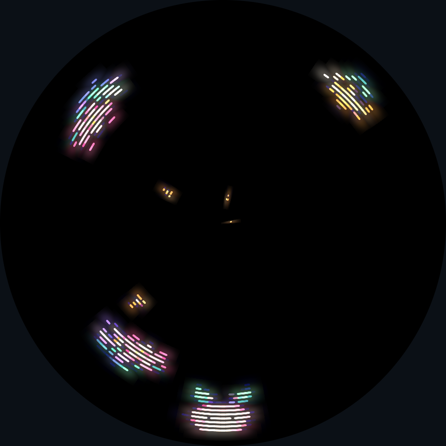
</div>

Notes:
**18:45–21:15.** Open the second cumulative version. It adds timed seeds, collision and planting, but keeps one player and leaves clouds, HUD, scenes and sound for the final version. The overlap test uses angular and depth bounds, including wrap at column zero. Explain only the response needed to see the game’s shape: plant at the catching player’s Y, offset 75% of their width toward movement. After stopping, the first catch follows the last direction and later catches alternate. Flowers drift inward far more slowly than seeds move outward. Misses do no harm. Have the audience predict which side a flower will appear on, then demonstrate. The full helper is in the download; avoid reading its arithmetic line by line. Reserve roughly a minute for live play.

Sources: [Game instructions and source](examples/dream-garden-guide.html), [collision](../../docs/vs2/tutorial/sprites.html). Image: the actual planting checkpoint through WebGL.

---

<!-- .slide: id="assets" data-talk-part="coding" data-timing="100" -->

## Art stays separate from game logic

<div class="split">

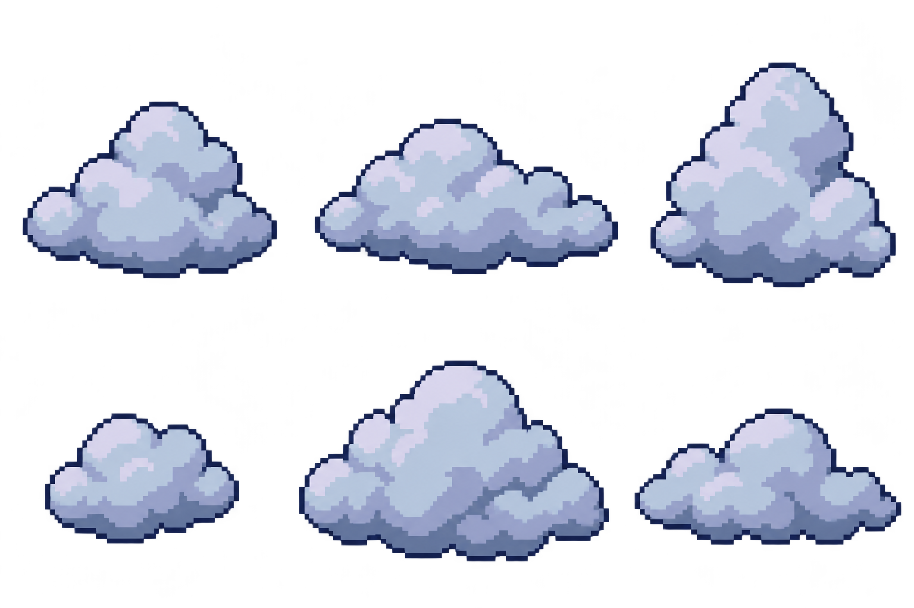
</div>

<p class="caption">PNG strips hold frames. Palette groups hold up to 256 colours.</p>

Notes:
**21:15–22:55.** Keep both atlases from the original presentation, but reduce the asset pipeline to what matters here. The runtime builds an indexed image ROM from the PNG strips and YAML manifest. Dreamers and flowers share one palette group; clouds have another so they can stay subdued. Animated frames have equal dimensions and sit side by side in a strip. The large clouds become adjacent 16-pixel cells, so one shape can span two cells or a three-by-two block. Original art stays separate from code and can be replaced. Point artists at the downloadable files. Test the result on the disc, because rectangular art changes proportions and details compress near the centre. Leave conversion scripts and frame-count minutiae to the guide.

Source: [Artwork and rebuild recipes](examples/artwork.html). Images: the original source atlases, unchanged.

---

<!-- .slide: id="draw-order" data-talk-part="coding" data-timing="90" class="compact" data-progression="11-audio" -->

## Depth, draw order and readable text

```python
self.air = self.layer("air", projection=vs2.TUNNEL)
self.ground = cloud_tiles(self.air)
self.seeds = self.air.sprite_pool("seed.png", count=16)

hud = self.layer("hud", projection=vs2.HUD)
hud.label("steel8x8.png", columns=5, x=108, y=1,
          flip_x=True, flip_y=True, text="RELAX")
```

Clouds first, seeds above them. HUD text near the rim.

Notes:
**22:55–24:25.** This is an excerpt from the complete version, following its lower world layer. Layers draw in creation order, and drawables draw in creation order inside each layer. Reserve clouds before seeds, and flowers before players. A scrolling tilemap changes its view instead of creating new actors. The map and sprites share the tunnel projection, so both curve into the disc. HUD uses LED rows, keeping text near the wider outer cells. At the top, flip both axes so text reads upright. The full-screen projection is also available for a single centred picture, while the completed Garden uses lower world, middle air and top HUD. These are display-specific choices; the collision and input logic will feel familiar to experienced developers.

Sources: [Draw order and projections](../../docs/vs2/tutorial/display.html), [tilemaps and text](../../docs/vs2/tutorial/tilemaps-and-text.html), [finished source](examples/dream_garden.py).

---

<!-- .slide: id="finished-demo" data-talk-part="coding" data-timing="130" data-progression="11-audio" -->

## Stage 3: the completed shared garden

<a class="checkpoint-launch" href="../../emulator/?game=demos.dream_garden&amp;checkpoint=11-audio" data-checkpoint="11-audio" target="_blank" rel="noopener">Play the finished game</a>

<div class="split">
<div>
<p>Invite a second player into the same garden.</p>
<p>Hold A to relax the seed flow. Clouds keep moving.</p>
<p>N toggles music and sounds. B keeps the flowers in a resting scene.</p>
</div>

</div>

Notes:
**24:25–26:35.** Run the completed game, exactly the final source. A begins. A/D steer player one, arrows steer player two, and Space or numpad zero asks for slower seeds. Release the start press before holding A to relax. Show the three visible layers and the way golden seeds remain above the clouds. Point out an occasional glow and the flowers’ much slower inward drift. Either player can slow seeds; clouds and flower animation keep their own steady pace. Planting direction is independent for each player. Music and bloom sounds start on. N switches audio, with a two-second NOISY or QUIET notice that slides out. B voluntarily rests with the planted flowers; A begins another dream. Keep the demonstration focused on the differences of this display and the shared interaction. The default desktop setup is the development path; the browser launch is a quick demonstration. No hardware assembly is required to join the jam.

Sources: [Complete source](examples/dream_garden.py), [game guide and download](examples/dream-garden-guide.html). Image: the real populated game through WebGL.

---

<!-- .slide: id="next-game" data-talk-part="coding" data-timing="25" -->

## Your next circular game

[Join the jam on itch.io](https://itch.io/jam/ventilastation-overkill-jam)

[Desktop setup](../../docs/guides/desktop.html)

[Dream Garden source and complete download](examples/dream-garden-guide.html)

[Ventilastation API](../../docs/vs2/reference/index.html)

Notes:
**26:35–27:00.** Finish the timed coding section at minute twenty-seven. Ask people to form teams and choose one interaction that uses the centre, the rim, rotation or shared play. The linked guide and reference cover the material omitted from this shorter talk. Stay for questions and open play without assigning them part of the fifteen-minute coding slot.

Sources: the linked official jam page and current documentation.
